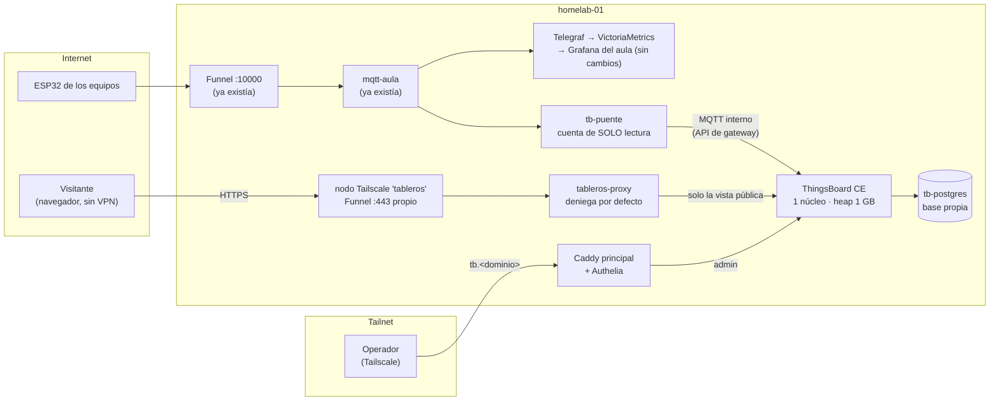

# ThingsBoard — tableros IoT de los proyectos

ThingsBoard Community Edition (CE) es una plataforma IoT de código abierto:
recibe la telemetría de las placas, guarda la historia y arma **tableros**
(dashboards). Acá cumple un objetivo puntual:

- un tablero **por proyecto** y tableros **generales** con varios proyectos;
- verlos en **varios monitores a la vez**;
- **publicar** los que se elijan en internet, para que cualquiera los abra desde un
  navegador, **sin VPN ni cuenta y en solo lectura**;
- mantener la **administración privada**.

**No reemplaza nada.** Grafana, VictoriaMetrics, Mosquitto, Node-RED, Postgres,
Caddy, Authelia y Tailscale siguen igual. ThingsBoard es un stack aparte
(`compose/thingsboard/`). Si en algún momento conviene migrar algo, se decide
cuando ThingsBoard ya esté probado en uso real.

> **Estado (15/10/2026):** desplegado en homelab-01, después de limpiar el
> disipador (59 °C con la CPU al 82 %). Se validó antes en una réplica local y
> con un converge del rol en un Ubuntu 24.04 descartable.

---

## Cómo está armado



| Pieza | Qué hace | Por qué así |
|---|---|---|
| `tb-puente` | Lee `mqtt-aula` y reenvía a ThingsBoard por la API de gateway (un token para todas las placas) | Las ESP32 **no cambian nada**: mismo broker, mismos topics. En CE no existen las "integraciones" MQTT, que son de la versión paga; y el Gateway oficial necesitaría un convertidor propio para copiar el contrato de Telegraf. El puente son ~200 líneas y **aplica exactamente el mismo contrato que `mqtt.star`**, con los mismos estados, el mismo JSON y los mismos topes (lo verifica un test). |
| `tb-postgres` | La base de ThingsBoard | **Propia, no la compartida del aula.** ThingsBoard escribe telemetría todo el tiempo: compartir el motor con las bases de los alumnos uniría sus fallas y sus cortes. Cuesta ~120 MB. Es el mismo criterio que el pañol. |
| `tableros-proxy` | Lo único de ThingsBoard que ve internet | La vista pública de CE **no se puede exponer tal cual** (ver [Seguridad](#seguridad)). |
| nodo `tableros` | Contenedor de Tailscale con **su propio** Funnel en el 443 | En `homelab-01`, el 8443 es del pañol, el 10000 del MQTT del aula, y el 443 del tailnet lo usa Caddy. Activar Funnel en ese 443 rompería Grafana, el pañol y la portada. |
| Caddy principal | `https://tb.<dominio>`: administración por el tailnet | Mismo esquema que el resto: Authelia (solo operadores) y además el login de ThingsBoard. |

**Formato de los datos.** El topic `<equipo>/<dispositivo>/<magnitud>` se
convierte en el dispositivo `<equipo>/<dispositivo>`, cuyo *tipo* es el equipo
(el proyecto), con una serie por magnitud. Por ejemplo, `equipo-01/estacion/temperatura`
con el payload `23.5` se convierte en el dispositivo `equipo-01/estacion` con la serie
`temperatura = 23.5`.

**Sin bucles y sin duplicados:**
- La cuenta `tb-puente` solo puede **leer** en `mqtt-aula` (ACL), y el puente
  publica en otro broker (el MQTT interno de ThingsBoard, sin puerto afuera).
- Los mensajes *retenidos* se saltean: si no, cada reconexión volvería a cargar el
  último valor con hora nueva.

**Sin pérdidas:**
- Del lado del aula, el puente se suscribe con QoS 1 y sesión persistente.
- Del lado de ThingsBoard, publica con QoS 1 y una cola de hasta 10 000 mensajes.
- Todo lo descartado se cuenta en `tb_puente_mensajes_total`.

### Redes Docker

| Red | Quién | Para qué |
|---|---|---|
| `thingsboard` (**interna**, sin salida) | ThingsBoard, su base, el puente, el exportador, el proxy público | Tráfico interno |
| `thingsboard-publico` | `tableros-proxy` ↔ nodo `tableros` | La única por la que entra internet |
| `edge` (existente) | ThingsBoard (admin por Caddy), métricas | Igual que el resto de los servicios |
| `classroom-shared` (existente) | Solo `tb-puente` | Llegar a `mqtt-aula` |

**Ningún puerto en el host**, salvo `127.0.0.1:18080`, que usa el aprovisionamiento.
No hay reglas de UFW nuevas.

---

## Antes de desplegar

El informe de infraestructura del 14/10/2026 (fuera del repo, en los documentos
del operador) detectó dos cosas que frenan el despliegue:

1. **Temperatura.** La CPU llega a **96–99 °C todas las noches** (01:50–06:00:
   AIDE, actualizaciones) con un uso promedio de apenas 20–40 %. Un disipador sano
   quedaría en ~70 °C con esa carga.
   - **Qué hacer:** limpiar el disipador y cambiar la pasta térmica. Desplegar cuando
     el máximo nocturno quede por debajo de **85 °C** durante una semana. Se ve en el
     panel "CPU del servidor (temp.)" del dashboard *ThingsBoard* de Grafana, o con:
     ```bash
     # En la notebook (o donde haya acceso al tailnet), por SSH:
     ssh ansible@homelab-01 "curl -s --get http://127.0.0.1:9090/api/v1/query --data-urlencode 'query=max_over_time(max(node_hwmon_temp_celsius{chip=\"platform_coretemp_0\"})[7d:5m])'"
     ```
   - **Mitigaciones que ya trae el stack:**
     - ThingsBoard tiene un **tope de 1 núcleo**;
     - el respaldo corre a las **13:40**, fuera de la ventana caliente;
     - la instalación hay que correrla de día.
2. **Respaldo.** Hasta que haya un disco en `/mnt/backup`, el volcado diario queda en
   el mismo SSD. Fue una decisión del 14/10/2026. Protege de errores y de una
   actualización fallida, **no** de que se rompa el disco.

**Checklist:**

- [ ] Temperatura nocturna máxima < 85 °C durante una semana.
- [ ] Hay ~2 GB de RAM libres: `free -h` en el server, columna *available*.
- [ ] Hay ~3 GB libres en `/`: imágenes (~1,3 GB) más la base.
- [ ] Decidido qué proyectos se publican (`thingsboard_proyectos_publicos`).
- [ ] Si se va a publicar: auth key de Tailscale a mano (ver [Publicar](#publicar-en-internet)).

---

## Desplegar

**Dónde:** en homelab-01, como `homelab`, en `~/homelab`. Los cambios de
configuración llegan por PR → merge → `git pull`, igual que siempre.

1. **Prender ThingsBoard en el inventario.** Se hace en el repo (en la notebook) y
   se sube por PR:
   ```yaml
   # ansible/inventories/production/group_vars/all/thingsboard.yml
   thingsboard_enabled: true
   # Proyectos que se publican (por defecto, ninguno: todo privado).
   thingsboard_proyectos_publicos: []
   # Opcional: títulos lindos por equipo.
   # thingsboard_titulos: { equipo-01: "Estación meteorológica" }
   ```
   **Por qué en un archivo aparte:** se apaga y se prende sin tocar el roster del aula.

2. **Bajar las imágenes con tiempo (opcional, recomendado).** Son ~1,3 GB y la
   conexión del server es lenta. Se pueden pasar desde la notebook por la LAN:
   ```bash
   # En la notebook, si ya tiene las imágenes:
   docker save thingsboard/tb-node:4.3.1.6 prometheuscommunity/postgres-exporter:v0.19.1 \
     tailscale/tailscale:v1.104.1 | ssh ansible@homelab-01 docker load
   ```

3. **Correr el play, de día.** Primero da de alta las cuentas de `mqtt-aula`
   (`tb-puente`, `tb-demo`) y después levanta todo:
   ```bash
   # En homelab-01, como homelab:
   cd ~/homelab && git pull
   cd ~/homelab/ansible
   ~/homelab/.venv/bin/ansible-playbook site.yml --tags shared-services,thingsboard -K
   ```
   - ⚠️ **`mqtt-aula` se reinicia una vez**, al sumar las cuentas. Las placas se
     reconectan solas en segundos. Avisar si hay una clase en curso.
   - La primera vez **instala la base** (1,5–3 min con 1 núcleo). Las siguientes no.
   - El aprovisionamiento crea el tenant, el admin, el gateway del puente, los
     dashboards y lo público. Es idempotente: repetirlo no cambia nada.

4. **Verificar:**
   ```bash
   # En homelab-01:
   docker ps --filter name=thingsboard --filter name=tb- --filter name=tableros
   sudo cat /srv/tableros/.tableros.json          # links de los tableros
   ```
   La administración queda en `https://tb.<dominio>`, por el tailnet. Se entra con
   Authelia (operador) y después con ThingsBoard:
   - **Usuario:** `admin@tableros.isft238.local`
   - **Clave:** `sudo cat /etc/thingsboard/secrets/admin.pass`

   El usuario `sysadmin@thingsboard.org` (administra la plataforma entera) tiene su
   clave en `sysadmin.pass`. **No hay ninguna clave de fábrica activa:** el
   aprovisionamiento cambia la del sysadmin en la primera corrida.

### Secretos

Se generan **en el host**, una sola vez, en `/etc/thingsboard/secrets/`
(root, 0700). No van al repo ni al vault. Para rotar uno, se borra el archivo y se
vuelve a correr el play.

| Archivo | Qué es |
|---|---|
| `db.pass` | Dueño de la base `thingsboard` |
| `monitoreo.pass` | Rol `monitoreo` (`pg_monitor`) del exportador: ve estadísticas, **no** lee datos |
| `jwt.key` | Firma de las sesiones. La de fábrica es pública: con ella cualquiera se fabrica un token de administrador. **Rotarla cierra todas las sesiones.** |
| `sysadmin.pass`, `admin.pass` | Logins de ThingsBoard |
| `gateway.token` | Token del gateway `tb-puente` |
| `tailscale.authkey` | Solo para que el nodo `tableros` se una la primera vez (lo pone el operador) |

Las claves MQTT del puente y del simulador las genera `shared_services`, igual que
las demás.

---

## Publicar en internet

El nodo `tableros` es un dispositivo más del tailnet, con Funnel en su propio 443.
La URL pública queda `https://tableros.tail4eda13.ts.net/`.

1. **Auth key**, una sola vez, desde la consola de Tailscale (*Settings → Keys →
   Generate auth key*). Conviene que sea *reusable: no* y *pre-approved: sí* (el
   tailnet tiene *Device approval* activado).
   ```bash
   # En homelab-01:
   sudo install -m 600 /dev/stdin /etc/thingsboard/secrets/tailscale.authkey <<< 'tskey-auth-...'
   ```
2. **Funnel para ese nodo.** Si la política del tailnet ya da Funnel a todos los
   miembros (`nodeAttrs` con `"attr": ["funnel"]` para `autogroup:member`), no
   hay que hacer nada. Si no, hay que sumarlo en *Access controls*.
   **Es un cambio en la configuración global de Tailscale:** lo hace el operador.
3. **Prender la publicación**: `thingsboard_publico_enabled: true` en el
   inventario, y otra vez `--tags thingsboard`.
4. **Probar desde afuera.** Desde un celular **con WiFi apagado** (datos móviles),
   abrir `https://tableros.tail4eda13.ts.net/`. Después, desde cualquier máquina:
   ```bash
   python3 compose/thingsboard/scripts/probar-acceso-publico.py \
     https://tableros.tail4eda13.ts.net \
     --dashboard '<link de un tablero público>' --privado <id de uno privado>
   ```
   Tiene que terminar en **"Todo en orden."** Los links salen de
   `/srv/tableros/.tableros.json`.

Una vez que el nodo se unió, la auth key ya no hace falta: el estado queda en el
volumen `thingsboard_tableros_ts`. Se puede borrar el archivo.

---

## Seguridad

### Lo que se encontró en ThingsBoard CE 4.3.1.6

Probado contra la instancia **directa**, sin proxy. Quien abre **cualquier** link
público obtiene un token llamando a `POST /api/auth/login/public` con el
`publicId` que trae el link. Con ese token:

| Acción | Directo | A través de `tableros-proxy` |
|---|---|---|
| Leer los dispositivos y dashboards **privados** | ❌ 403 | ❌ 404 |
| Ver la administración, usuarios, auditoría | ❌ 403 | ❌ 404 |
| **Escribir telemetría falsa** en un dispositivo público | ⚠️ **200, se guarda** | ❌ 404 |
| **Escribir atributos** (incluidos los compartidos, que bajan a la placa) | ⚠️ **200** | ❌ 404 |
| **Mandar un comando (RPC)** a un dispositivo público | ⚠️ **200** | ❌ 404 |
| **Leer el token de acceso** de un dispositivo público | ⚠️ **200** | ❌ 404 |
| Listar los dispositivos públicos, consultar por REST | 200 | ❌ 404 |
| `/actuator/prometheus` (métricas) | ⚠️ **200 sin login** | ❌ 404 |
| Pantalla de login de administración | 200 | ❌ 404 |

**Conclusión:** en CE, la separación entre lo público y lo privado **existe**
(lo privado da 403), pero lo público **no es de solo lectura**. Por eso:

1. **`tableros-proxy` deja pasar solo lo que usa la vista pública**, capturado con
   un navegador real:
   - la página `/dashboard/<id>?publicId=<id>` y los archivos estáticos;
   - `POST /api/auth/login/public` y `POST /api/auth/token` (renovación), los
     **únicos POST**;
   - cuatro `GET`: `/api/dashboard/<id>`, `/api/dashboard/serverTime`,
     `/api/system/params` y `/api/widgetType`;
   - el WebSocket `/api/ws`, donde viajan los datos (solo suscripciones).

   Todo lo demás da **404**. Encima hay *rate limit* por IP y los cuerpos de los
   pedidos están limitados a 8 KB.
2. **Las placas no reciben comandos desde ThingsBoard.** Los dispositivos de
   ThingsBoard son **espejos** que alimenta el puente: un RPC no llega a ninguna
   ESP32, aunque alguien lo lograra.
3. **Lo público se reconcilia en cada corrida.** Un dashboard o dispositivo que ya
   no figura como público **se despublica**. El gateway nunca es público. Así nada
   queda expuesto "porque alguna vez se publicó".
4. **Métricas:** `/actuator/*` se bloquea también en el vhost de administración.
   Prometheus las lee directo por la red `edge`.
5. **Sin datos personales:** los dispositivos y dashboards se nombran por **equipo**
   (`equipo-01`), nunca por alumno. Un test lo controla.

### Al actualizar ThingsBoard

La lista de rutas está atada a cómo funciona la interfaz de **esta** versión. Si
cambia la versión:

1. Volver a capturar las rutas con `scripts/capturar-rutas-publicas.js` (ver el
   README del stack).
2. Correr `scripts/probar-acceso-publico.py` contra la instancia nueva. En el
   dashboard de Grafana, el panel "Proxy público: pedidos por código" muestra
   404 si la interfaz nueva pide una ruta que no está en la lista.

### Quién ve qué

| Persona | Entra por | Ve |
|---|---|---|
| Visitante | `https://tableros.<tailnet>.ts.net/` | Solo los tableros publicados, de solo lectura |
| Operador | `https://tb.<dominio>` (tailnet + Authelia + login de ThingsBoard) | Todo |
| Alumno | — | No tiene acceso de administración. Sus datos siguen en su Grafana del aula, como siempre |

---

## Proyectos y tableros

Se arman **solos desde el roster** (`classroom.yml`):

| Dashboard | Contenido | Público |
|---|---|---|
| `Proyecto — <equipo>` | Tabla con el último valor de cada placa + un gráfico por magnitud. **Clic en una fila** abre la vista de **esa placa** | No, salvo que esté en `thingsboard_proyectos_publicos` |
| `Aula — Todos los proyectos` | Todos los equipos juntos | No |
| `IoT — General` | Los proyectos de demo (configurable: `thingsboard_dashboards_generales`) | Sí |
| `Estación meteorológica`, `Seguridad IoT`, `Sensores ambientales` | La demo (simulador) | Sí |

- **Sumar un proyecto nuevo** es sumar el equipo al roster y correr
  `--tags shared-services,thingsboard`. La arquitectura no cambia.
- **Un gráfico por magnitud:** si no, la presión (~1013) aplasta a la temperatura
  (~20) en la misma escala.
- **Los dashboards se rehacen solos** cuando aparece una magnitud nueva, la
  próxima vez que corre el aprovisionamiento.
- **Los dashboards hechos a mano** en la interfaz **no se tocan nunca**. El script
  solo actualiza los que llevan la marca `gestionado por tb-provision` en la
  descripción. Para publicar uno hecho a mano: en la interfaz, *Make public*, y
  asignar sus dispositivos al cliente *Public*. ⚠️ Ojo: la próxima corrida retira
  del público los dispositivos de proyectos que no están en
  `thingsboard_proyectos_publicos`. Si se quiere un dashboard público a mano, su
  proyecto tiene que figurar ahí.

### Espacios de equipo (alumnos administradores)

Un equipo puede tener su **propio tenant** de ThingsBoard, con sus alumnos como
**administradores**: crean y editan dashboards, manejan sus dispositivos y
arman reglas, aislados del resto. Ni ven el aula ni el aula los ve; probado:
abrir un dashboard del tenant del aula le da 403.

```yaml
# ansible/inventories/production/group_vars/all/thingsboard.yml
thingsboard_equipos_admin:
  - { equipo: equipo-01, usuarios: [dardo] }
```

- **Entrada:** `https://tb.<dominio>` por el tailnet. Primero Authelia, con el
  usuario y la clave **del aula**: la regla deja pasar a los operadores y a
  estos alumnos. Después ThingsBoard, con `<usuario>@isft238.local` y una clave
  **propia**, que genera el rol en `/etc/thingsboard/secrets/tb-usuario-<usuario>.pass`.
  No se reusa la del aula porque ThingsBoard exige 6 caracteres o más.
- **Datos:** el puente manda lo de `<equipo>/#` a su tenant por un gateway con
  token propio (`gateway-<equipo>.token`). El tenant del aula lo sigue recibiendo.
- **Dashboard de arranque:** lo crea `tb-provision`, que corre cada 10 minutos
  (`tb-provision.timer`), **una sola vez** y cuando ya hay datos. Después es
  del equipo y no se pisa.
- **Ojo:** como administrador de su tenant, el alumno *puede* publicar sus
  dashboards. La vista pública sigue pasando por `tableros-proxy`, así que
  es de solo lectura igual.
- Guía para el alumno: ver `~/Documents/acceso-dardo-thingsboard.txt` como
  modelo (fuera del repo, porque lleva claves).

### Monitores (pantalla completa)

Cada tablero público tiene un link fijo. Para un monitor:

```bash
# En la máquina del monitor (cualquier Linux con Chromium):
chromium --kiosk --noerrdialogs --disable-session-crashed-bubble \
  '<link del tablero>'
```

En Windows es lo mismo con Chrome (`chrome.exe --kiosk "<link>"`), o **F11** en
cualquier navegador. La portada (`/`) lista todos los tableros publicados.

- **Monitor 1:** `IoT — General`.
- **Monitor 2:** `Estación meteorológica`.
- **Monitor 3:** `Seguridad IoT`.
- **Monitor 4:** `Sensores ambientales`.

Cada monitor es una sesión pública aparte. Hay un tope de **100 pestañas públicas
abiertas a la vez, entre todas** (`thingsboard_limites`).

**Pantallas abiertas por horas (probado).** La sesión pública dura 2,5 h. Para
probar, se la acortó a 90 s y se dejó un tablero abierto 5 minutos:

- **Mientras la conexión sigue abierta,** los datos llegan sin cortes, aunque el
  token venza: el WebSocket se autentica una sola vez, al abrirse.
- **Si se corta la conexión con el token vencido,** la interfaz lo renueva sola
  (`POST /api/auth/token`, que el proxy permite) y reabre el WebSocket en ~2 s.

No hace falta recargar los monitores.

**Página central.** Se evaluó usar *Homepage*: está detrás de Authelia y solo
se ve por el tailnet, así que no sirve para el público. Por eso la portada pública
es una página estática que escribe el aprovisionamiento. Sumar los links a
Homepage, para uso interno, queda como mejora.

---

## Recursos

**Medido** en la réplica local (14/10/2026): ThingsBoard 4.3.1.6 con 1 núcleo de
tope, heap de 1 GB, 5 dashboards públicos, el simulador publicando 9 valores cada
10 s, y espectadores que eran **navegadores reales** (Chromium), cada uno con su
propia sesión pública.

| | Reposo | 10 espectadores | 20 espectadores |
|---|---|---|---|
| ThingsBoard: CPU media / pico | 10 % / 14 % | 12 % / 74 % | 14 % / 66 % |
| ThingsBoard: RAM | 1,10 GB | 1,11 GB | 1,12 GB |
| tb-postgres: CPU media / RAM | 0,6 % / 116 MB | 4,6 % / 119 MB | 8,6 % / 118 MB |
| tb-postgres: transacciones/s | 3 | 188 | 340 |
| tableros-proxy: RAM | 22 MB | 35 MB | 39 MB |
| tb-puente: RAM | 14 MB | 14 MB | 14 MB |
| Carga del tablero (mediana / máx.) | — | 1,47 / 1,61 s | 1,48 / 1,74 s |
| Latencia placa → navegador (mediana / p95) | — | 31 / 34 ms | 27 / 34 ms |
| Errores | — | 0 | 0 |

CPU en % de **un** núcleo de la notebook (i7-11850H). En el i5-4460 del server
hay que multiplicar por **~1,7**.

**Lectura:**

- **La RAM no depende de los espectadores.** El total del stack ronda los
  **~1,3 GB**: ThingsBoard 1,1, la base 0,12 y el resto ~0,1.
- **La CPU sube al abrir el tablero**, no al mirarlo. Con 20 espectadores en
  régimen, el server usaría ~25 % de un núcleo (~6 % de la máquina).
- **Las consultas a Postgres crecen con los espectadores**, ~17 transacciones/s
  por cada uno. Es lo primero a vigilar si se publican tableros muy pesados.
- **Instalación:** 83 s (notebook), con un pico de 1 núcleo y 870 MB.
  **Arranque:** 56–82 s.

**Red** (medido; la subida del server en el sitio actual es de ~9–13 Mbit/s):

| | Por espectador |
|---|---|
| Primera visita (descarga la interfaz) | **4,7 MB** |
| Visita con el navegador ya cacheado | 85 KB |
| Mirando, en régimen (tablero general) | **~1,9 KB/s** (~15 kbit/s) |

### ¿Cuánto aguanta? (estimado)

- **Mirando en régimen:** 20 espectadores usan el 3 % de la subida. Por
  ancho de banda entrarían cientos. El límite práctico lo ponen la CPU de
  Postgres y el tope de 100 sesiones públicas. **Estimación razonable: 40–60
  espectadores simultáneos** sin degradar el resto del server.
- **Llegadas simultáneas:** es el cuello de botella real. 20 primeras visitas en
  el mismo minuto son ~94 MB, unos 70 s de subida a pleno. Para un evento (una
  muestra), conviene abrir los monitores **antes**, y que el público entre
  de a poco o escanee un QR.
- **Dashboards:** decenas, sin problema. Un dashboard sin nadie mirando no
  consume nada.

---

## Observabilidad

- **Grafana de operación → carpeta Homelab → *ThingsBoard*.** Muestra:
  - estado (ThingsBoard arriba, puente conectado a los dos lados, último dato);
  - pestañas públicas abiertas, reinicios y tamaño de la base;
  - **temperatura de la CPU**;
  - CPU y RAM por contenedor, heap y GC de la JVM;
  - pedidos HTTP por estado, pedidos del proxy público por código (los 404 y 429
    se ven ahí), tráfico hacia internet, mensajes del puente por resultado,
    latencia y transacciones de Postgres.
- **Jobs de Prometheus:** `thingsboard` (`/actuator/prometheus`), `tb-puente`,
  `tb-postgres` (postgres-exporter) y `tableros-proxy` (métricas de Caddy). Si
  ThingsBoard no está desplegado, figuran caídos, y es lo esperado.
- **Logs:** solo por la salida estándar, rotados por Docker (10 MB × 3). Se
  quitó el log de GC a archivo de la imagen.
  ```bash
  docker logs --since 1h thingsboard
  ```

---

## Respaldo y recuperación

**Qué se respalda:** la base de ThingsBoard, que tiene todo (dispositivos,
dashboards, usuarios, telemetría). El resto se reconstruye desde el repo y
`/etc/thingsboard/secrets/`.

- **Cuándo:** todos los días a las 13:40 (`tb-backup.timer`). Si el server estaba
  apagado, corre al prender.
- **Dónde:** `/var/backups/thingsboard/thingsboard-AAAAMMDD-HHMMSS.dump`, root
  0700. Se guardan los últimos 7.
- **Cómo:** `pg_dump -Fc` dentro de `tb-postgres`. Primero se verifica que el
  volcado se pueda leer (`pg_restore --list`) y recién ahí se le da el nombre final.
- **Medido:** 20 MB comprimido para una base de 54 MB, en 6 s.

```bash
# En homelab-01 — respaldo a mano:
sudo systemctl start tb-backup.service && sudo journalctl -u tb-backup -n 3
```

⚠️ **También hay que guardar `/etc/thingsboard/secrets/` fuera del server.**
Sin `jwt.key` y las claves, la base restaurada anda, pero hay que volver a
generar sesiones y tokens. Cuando exista `/mnt/backup`, sumar
`/var/backups/thingsboard` y `/etc/thingsboard` a borgmatic.

### Restaurar (procedimiento probado)

Probado el 14/10/2026: volcado → Postgres nuevo → ThingsBoard nuevo encima.
Arrancó en 50 s, el administrador entró y estaban los 7 dispositivos y los 6
dashboards. La restauración tardó 1 s.

```bash
# En homelab-01, como homelab, en el directorio del stack:
cd /opt/homelab/stacks/thingsboard
sudo docker compose stop thingsboard tb-puente tb-postgres-exporter    # nadie escribe
D=thingsboard-AAAAMMDD-HHMMSS.dump                                     # el volcado elegido
sudo docker exec tb-postgres psql -U thingsboard -d postgres \
  -c "DROP DATABASE thingsboard WITH (FORCE)" -c "CREATE DATABASE thingsboard OWNER thingsboard"
sudo docker exec tb-postgres pg_restore -U thingsboard -d thingsboard --no-owner --exit-on-error /backups/$D
sudo docker compose up -d                                              # vuelve todo
```

⚠️ El `DROP DATABASE` **borra** la base actual. Hacerlo solo después de un
respaldo nuevo (`systemctl start tb-backup`), por si el volcado elegido no era
el correcto. Después hay que volver a correr el play (`--tags thingsboard`),
que repone el rol `monitoreo` y reconcilia lo público.

---

## Actualizar ThingsBoard

1. **Respaldo a mano:** `sudo systemctl start tb-backup.service`.
2. Cambiar `thingsboard_version`, en el rol o en el inventario.
3. **Migrar la base**, con el stack parado:
   ```bash
   cd /opt/homelab/stacks/thingsboard
   sudo docker compose stop thingsboard tb-puente
   sudo docker compose run --rm -e UPGRADE_TB=true -e FROM_VERSION=4.3.1.6 thingsboard
   ```
   Hay que poner la imagen nueva en `.env` (`TB_VERSION`) antes. El play lo hace
   si se corre con la versión nueva, pero **no** corre la migración: es a propósito,
   para que no pase sin que alguien la mire.
4. `--tags thingsboard` y **volver a probar la superficie pública** (ver
   [Al actualizar ThingsBoard](#al-actualizar-thingsboard)).

---

## Desactivar (rollback)

Apagar ThingsBoard **no toca** Grafana, VictoriaMetrics, Mosquitto, Node-RED, el
Postgres compartido, Caddy ni Tailscale, y **no borra datos**.

```bash
# En homelab-01:
cd /opt/homelab/stacks/thingsboard
sudo docker compose --profile demo --profile publico down     # SIN -v: los volúmenes quedan
sudo systemctl disable --now tb-backup.timer
sudo rm /opt/homelab/stacks/proxy/conf.d/thingsboard.caddy && docker exec caddy caddy reload --config /etc/caddy/Caddyfile
```

Y en el repo, `thingsboard_enabled: false`. La próxima corrida de
`--tags shared-services,auth` saca las cuentas `tb-puente` y `tb-demo` de
`mqtt-aula` (lo reinicia una vez) y la regla de Authelia.

| Se queda (para volver atrás del rollback) | Dónde |
|---|---|
| Base de datos | volumen `thingsboard_tb_postgres` |
| Estado del nodo `tableros` | volumen `thingsboard_tableros_ts` |
| Volcados | `/var/backups/thingsboard/` |
| Secretos | `/etc/thingsboard/secrets/` |

El nodo `tableros` sigue figurando en la consola de Tailscale hasta que se lo
borre a mano (*Machines*). Mientras el contenedor esté apagado, no expone nada.

**Volver a prender:** `thingsboard_enabled: true` y `--tags shared-services,thingsboard`.
Retoma la misma base: no reinstala.

---

## Limitaciones conocidas

- **La vista pública de CE no es de solo lectura por sí misma.** La protege
  `tableros-proxy`. Si alguien expone ThingsBoard por otro camino (un puerto, otro
  túnel), pierde esa protección.
- **Disponibilidad:** si el server pierde la red, los tableros públicos dejan de
  verse. Las ESP32 también dejan de llegar, porque entran por Funnel. Una página
  "última foto" en un hosting estático quedó propuesta y no está implementada.
- **Funnel:** Tailscale no publica límites de ancho de banda. Para eventos
  grandes, Cloudflare Tunnel con caché sería mejor, pero necesita dominio propio.
- **Monitores en la LAN:** hoy entran por la URL pública, es decir, por internet.
  Que entren por la LAN ahorraría subida y los mantendría andando sin internet,
  pero requiere una regla de firewall (pendiente).
- **El 404 tapa el login de admin en el sitio público**, pero un dashboard
  público sin `publicId` en la URL también da 404. Hay que compartir siempre el
  link completo.
